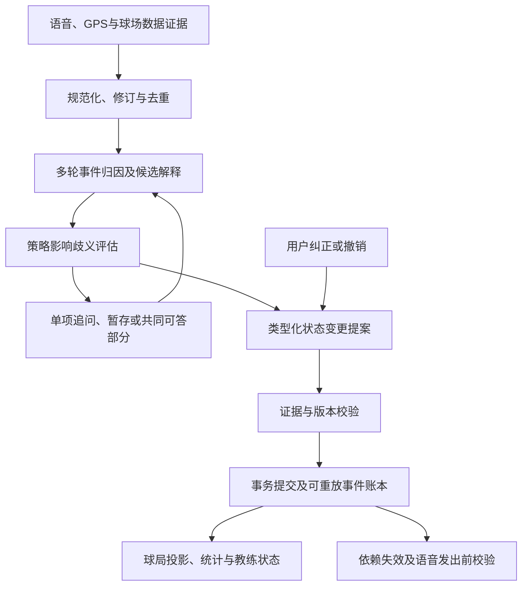

# 下一阶段核心架构：结构化球局状态引擎

一种基于多轮语音事件归因、策略影响歧义评估和可回滚状态更新，持续维护结构化高尔夫球局状态的系统及方法。

状态：架构目标与验收规范。技能v0.1.4已实现SQLite状态内核、候选归因与歧义比较、选择性回滚、依赖失效和本地入口，见 [运行与接入](round-state-runtime.md)。此文仍包含完整产品后续目标，不能据此宣称真实语音/GPS、APP接口或通用语言理解已接通。

## 1. 系统边界与数据流

用户可通过语音操作，后台联合语音、GPS和球场数据；三者是独立且互补的事实来源，详见 [三路输入联合规范](multimodal-inputs.md)。语音状态维护不意味着只使用语音。

目标是持续回答：现在可靠地知道什么、哪些解释尚未确定、哪些未知会影响当前服务，以及纠正后哪些结论必须重算。球局状态服务于球手的节奏，不以填满账本为目标。



大模型负责理解、候选解释和变更提案；确定性组件负责约束、提交、版本冲突、依赖失效与重放。模型不得任意写数据库或直接把推测升级为事实。

## 2. 四层数据，分别维护

| 层 | 主要字段与用途 |
| --- | --- |
| 输入证据 | owner/round、utterance_id、ASR修订号、partial/final、发生时间/接收时间、来源、质量、当时上下文快照；GPS观测是位置证据，不是击球事件 |
| 候选解释 | 说话对象、意图/实际行为/否定/假设、所指球洞和球杆、候选击球、关联问题ID、依据及未解歧义 |
| 结构化事实 | 当前实际球洞与话语所指球洞分开；球位、实际球杆、计划球杆、成绩、推数、罚杆分别记录；状态为待确认/已确认/估计/未知/已撤回 |
| 派生结果 | 距离、球杆统计、策略、教练判断，均带依赖字段版本、算法版本与有效性；不能反向充当原始证据 |

球杆、自报carry、GPS总距离不能混为同一字段；未知为null，不是0。一次改杆纠正不自动改落点，一次落点纠正可能使距离与相关统计失效。

ASR final仅说明转写结束，不代表内容属实。转写置信度、语义归因置信度、策略影响是三个维度，不合并成一个“可信分”。partial仅可用于可取消的界面预览，不正式提交。final仍按字段规则确认，成绩保存保留现有明确确认要求。

## 3. 多轮语音事件归因

归因同时参考未完成问题、用户明确指代、事件时序、当前球局和GPS；GPS不能压过“刚才一号洞”等明确表达。

- GPS进入二号洞后说“一号洞五杆”，更新一号洞候选成绩，不将当前实际球洞退回一号洞。
- 问“上一杆用了什么杆”后回答“三木”，绑定该问题的目标击球；不得绑定回答时最新位置的击球。问题失效或多个候选时先澄清。
- “本来想七铁，后来打了三木”：七铁是意图，三木才是实际球杆；“他打了六杆”不得记入本人。
- “不是七铁，是三木”：定位被纠正的球杆事实；没有唯一目标时问“你是说刚才开球那杆吗？”不猜测批量改动。
- “撤销刚才”：存在多个可撤销变更时先问撤销哪项；目标明确时执行补偿变更。

位置未知，先核实是否在球旁，不能同时追问球杆。已知起终点和单杆关联才可计算该段总距离；漏杆、救济移动或间断须断链。不由总杆差值补造切球、杆号或挥杆位置。

## 4. 策略影响歧义评估

不以“有没有歧义”决定打扰，而评估不同合理解释会不会改变当前输出或记录后果。

1. 保留有证据支持的候选解释与未覆盖的不确定性，不强行只留一个。
2. 在相同规则、地图和天气快照下，把候选输入只读策略评估器。
3. 比较可执行性、越障要求、目标区域、球杆选择，以及记分/罚杆、长期统计归属、静默和授权状态等后果。
4. 结果为：共同部分可回答、需澄清、暂缓，或影响未知。缺关键输入、模型报错、候选覆盖不足均为影响未知，不能判成无影响。

例：上一杆是三木还是一号木，不影响当前可靠的果岭中部145码，可以先报145码；杆号归属仍待确认，不进入球杆距离统计。两种球位解释会导致是否需要越水不同，则暂停具体过水建议，问一个最能区分解释的问题。

没有经过校准的模型，不制造“省几杆”“风险百分比”作为决策门槛。初期采用可审计的离散影响等级；未来概率或后悔值模型须另行验证。

每次最多一个待答问题；用户静默或准备击球时暂缓。主动提问仍须已有约定；优先处理用户当前请求及会影响当前决策的确认，漏记成绩与首次了解不能抢占击球节奏。无回应不是认可，也不反复催促。用户仅问距离不自动变成选杆咨询。

## 5. 类型化更新与事务

原始架构变更协议示例（概念字段；已实现Python接口使用value/status而非after，完整映射见运行规范）：

```json
{
  "patch_id": "p-27",
  "round_id": "r-1",
  "base_version": 18,
  "idempotency_key": "utterance-9-revision-2-club",
  "evidence_ids": ["utterance-9:2"],
  "question_id": "q-6",
  "operations": [{"path": "shots.s-3.actual_club", "before": "7i", "after": "3w"}],
  "read_versions": {"shots.s-3.actual_club": 4},
  "reason": "explicit_user_correction",
  "status": "proposed"
}
```

owner由认证上下文确定，不能信任客户端提交的用户ID。服务端验证允许修改的字段、证据、单位、确认状态、目标对象和读版本；未知字段路径或跨用户目标拒绝。总杆包含罚杆；已知推数与罚杆合计不能超过总杆；默认两推只能记估计，不能冒充确认用于精细训练。

提交事务包含：校验幂等键与载荷摘要、检查版本、追加变更事件、更新状态投影、标记派生依赖失效、写入语音outbox。相同键相同载荷返回同一结果，不重复应用；同键不同载荷拒绝。旧版本返回冲突，由调用方基于新状态重新提案，不静默覆盖。确认令牌绑定提案ID与版本，修改提案后旧确认失效。

保留提案、待确认、已提交、被替代、已撤回、被拒绝状态。正式保存失败不能口头宣称成功；无真实存储能力时只展示待确认账本。

## 6. 可回滚：追加纠正，选择性重算

回滚追加补偿事件，保留被纠正项的来源与版本关系；不恢复整局旧快照而丢弃之后正确的数据。

- 撤回球杆归属：保留独立成立的GPS距离为未分配，撤回该杆统计贡献；保留后来已确认的二号洞成绩。
- 撤回位置锚点：失效依赖该锚点的距离、球杆统计及策略；不自动失效独立自报的总杆。
- 更改推数或罚杆：重新验证成绩约束及依赖指标；不能倒推出未记录的杆型和位置。
- 更改静默或教练授权：取消相关待发提醒及任务；不得借回滚自动重开教练。

依赖图记录输入事实ID和版本，先标失效再按需重算。教练阶段结论若证据被撤回，应标为待复查，不沿用“已过关”。不存在可用依赖图时不得声称已完整回滚统计。

重放使用已批准的类型化变更和固定版本快照，按提交顺序确定性还原；不重新调用大模型猜一次。发生时间用于归因，提交顺序用于账本重放，两者分开。快照仅用于加速。

已经执行的击球和已经听到的语音不能撤销。宿主支持时可取消未播或中断语音；否则在安全空档简短纠正，不承诺物理回滚。原始录音、转写按授权与保留策略处理，删除不能被“不可变账本”架空；审计可保留必要的不含原文标识及删除标记。

## 7. 发声前再校验

每条待播内容带目标情境、相关字段读版本、依赖、有效期和主动/被动原因。真正发出前检查球位是否已变化、用户是否准备击球或要求安静、相关事实是否被纠正、规则功能是否允许。旧球位的选杆建议取消；主动GPS事件不能解除静默。用户明确问过去一洞时允许回答过去的事实，不能机械地因洞号不同拒绝。

语音outbox取消采用最佳可用宿主能力；不声称系统已经控制耳机、麦克风或锁屏。

## 8. 与现有原型的接入边界

v0.1.6新增独立认证会话接口和手机联调构建，接入范围见 [会话协议](round-session-protocol.md)；以下旧原型接入判断保留为历史边界，不代表本轮独立构建尚无接口。

已检查本地旧原型的API文档：已有 /chat、/sync、record版本、幂等operationId、版本冲突和成绩基础校验。/sync是记录级同步，/chat是聊天接口；旧原型尚未连接本次新增的状态引擎，领域库已在技能scripts中独立实现。当前原型地图就绪标志为false。

后续可以让/chat调用编排器；独立球局事件存储拥有事实真源，/sync同步投影而非另设事实真源。拟议能力为事件接收、状态读取、提案确认和撤回；具体URL与表结构在实现时确定，不把设计字段冒充现有API。

最低存储实体：证据事件、解释候选、变更提案、事实版本、依赖边、待答问题、语音outbox。位置、地图、天气和模型版本可追溯；缺球道海拔/果岭坡度仍为不可用。

## 9. 测试先行与分阶段实现

第一阶段：状态类型、纯reducer与下述契约场景；第二阶段：事务存储、版本冲突、幂等、重放及依赖回滚；第三阶段：确定性候选比较器与单问题调度；第四阶段：语音/GPS适配器影子运行，人工核对后逐步启用写入；最后进行真机语音、后台、断网与现场验证。影子模式不得修改正式记分。

核心契约场景（v0.1.4已将主要内核契约转为自动测试，覆盖及未完成边界见运行规范；本表不是全部产品能力已验证声明）：

| 输入或故障 | 必须观察到的结果 |
| --- | --- |
| partial后final修订、final重复投递 | partial不提交；同一final不重复记杆 |
| 到二号洞后补报一号洞成绩 | 归属一号洞，当前实际球洞不倒退 |
| 回答旧问题“三木” | 绑定原目标；目标失效则澄清 |
| 计划七铁、实际三木；同伴六杆 | 意图/实际分开，同伴不记本人 |
| 仅有总杆、推数及间断GPS | 不造缺失击球；两推默认标估计 |
| 两候选不影响当前距离 | 报共同可靠距离，未定杆号不入统计 |
| 候选改变过水条件；评估器报错 | 一个关键追问或暂缓，报错为影响未知 |
| 旧版本确认、跨用户目标、同键不同载荷 | 全部拒绝，不部分写入 |
| 纠正杆号，随后已有另一洞成绩 | 撤回旧统计，保留独立距离及后续成绩 |
| 撤回位置锚点 | 距离、统计、待播建议按依赖失效 |
| 静默后GPS换洞、迟到选杆语音 | 不主动发声，不播旧建议 |
| 重放与断网重试 | 状态等价；不重复变更或语音任务 |

验证指标：误归属字段率、无依据确认率、策略关键歧义漏检率、无关追问次数、纠正生效延迟、过期播报次数、依赖失效完整性、重放一致性。分别报告样本和场景，不用ASR识别率或聊天时长替代。真实基准建立前不公布达标率。


## 标准化归因落地（v0.1.7）

11类语音事件、逐杆归因链、三级影响、字段更正及学习候选撤回已实现本地确定性原型，详见 [逐杆归因协议](shot-attribution-protocol.md)。输入是标准化候选，本轮不新增ASR、云库或正式GPS APP接口。缺证据保留未知，与既有不完整账本规则一致。
